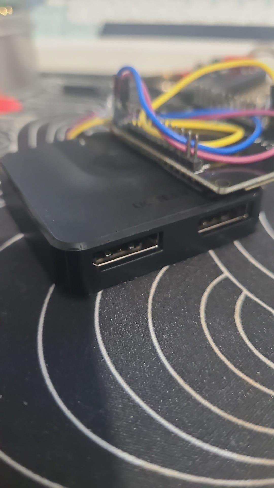
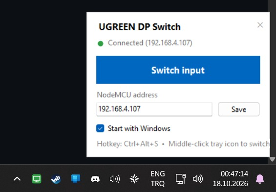
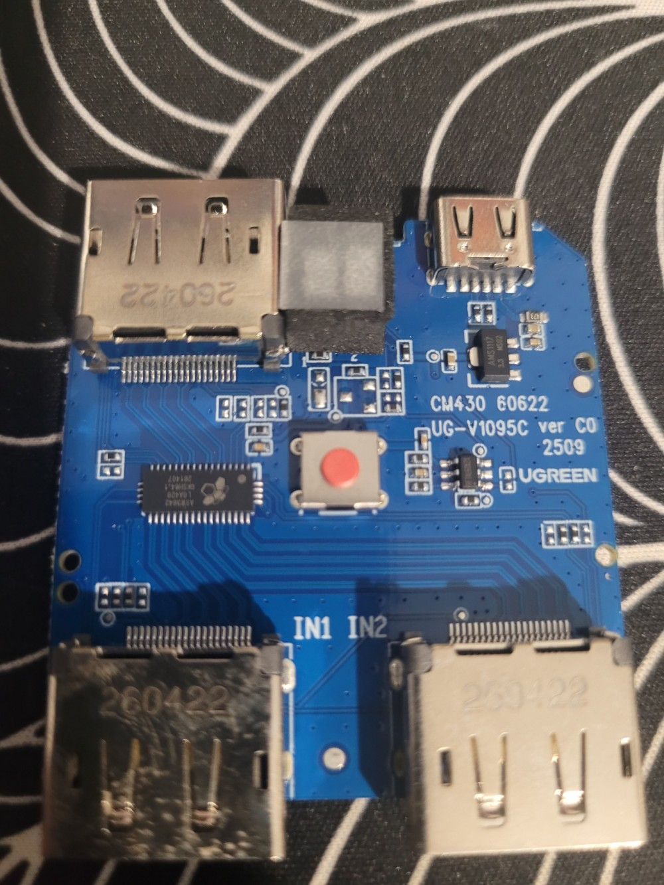
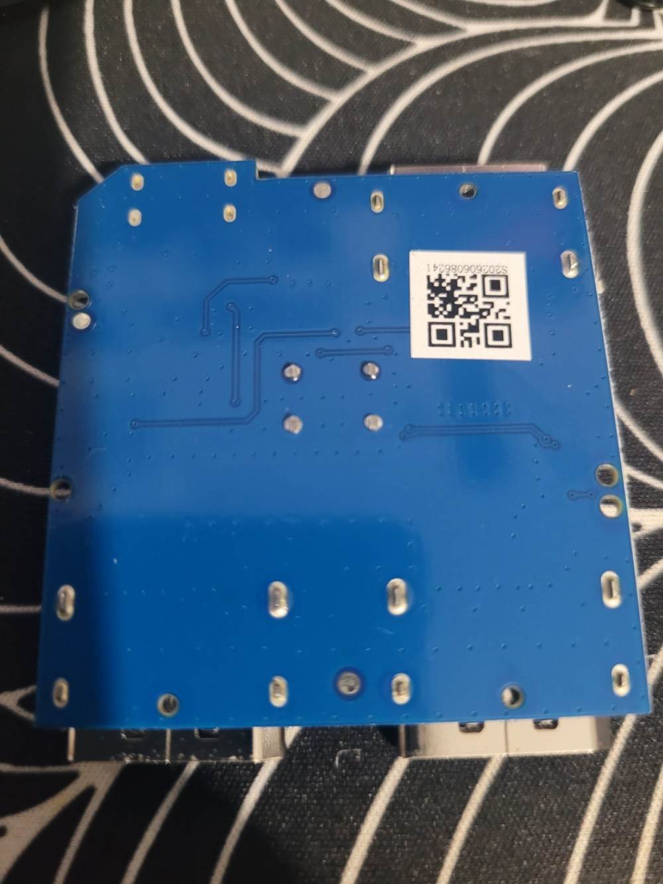

# UGREEN DP Switch – PC control

Control the input button of a **UGREEN CM430 (60622) DisplayPort 2↔1 switch** from the PC.
A NodeMCU (ESP8266) wired across the switch's push button "presses" it electronically, over Wi‑Fi or USB serial. The physical button keeps working.

<p>
  
  
</p>

## Project layout

```
firmware/ugreen_switch/ugreen_switch.ino   NodeMCU firmware
tray/UgreenSwitch.cs                       Windows tray app (source)
tray/build.bat                             builds tray/UgreenSwitch.exe
switch_dp.bat                              command-line switcher
images/                                    photos for this README
```

## Hardware

Switch board: `UG-V1095C ver C0`. The red-cap tact switch in the middle is active‑low: its signal leg sits at 3.3 V (pull‑up) and goes to 0 V when pressed.

<p>
  
  
</p>

- **Top‑left DP**: common port. **IN1 / IN2** (bottom): the two switched ports. The switch is bidirectional.
- **USB‑C**: auxiliary 5 V power. The **AMS1117** next to it makes 3.3 V for the logic.
- **QFP chip (left)**: passive DP lane mux. **8‑pin chip** next to the button: button logic and LED driver.
- **Button legs**: the 4 through‑hole pads in the middle of the back side are the tact switch's legs. These are the easiest place to solder the S1 and GND wires.

| Switch board                 | NodeMCU |
|------------------------------|---------|
| S1 – button signal leg (3.3 V) | **D1** |
| GND                          | **G**   |
| 5 V (from the board regulator) | **VIN** – never 3V3 |

The firmware only pulls D1 **low** or leaves it floating (open‑drain), so it never fights the board's pull‑up.

**Optional: input sense.** Wire the LED "1" pad to **D2** through 1 kΩ and set `HAVE_SENSE = true` in the sketch. `/1` and `/2` then go to that input (and do nothing if it is already active), and the tray app shows Input 1 / Input 2 buttons. Without it, every command is a single toggle.

## Firmware

Board: **NodeMCU 1.0 (ESP‑12E)**, core `esp8266:esp8266` 3.1.2, CH340 USB serial.

Upload with the Arduino IDE, or with arduino-cli:

```
arduino-cli compile --upload -p COM3 --fqbn esp8266:esp8266:nodemcuv2 firmware/ugreen_switch
```

Settings in the sketch:

| Constant        | Default | Meaning |
|-----------------|---------|---------|
| `PRESS_MS`      | 150     | press length in ms; raise to 300 if presses are missed |
| `HAVE_SENSE`    | false   | true once D2 is wired to the LED pad |
| `LED1_ON_LEVEL` | LOW     | level on D2 when input 1 is active |

### Wi‑Fi setup

Credentials are stored in the ESP8266's flash, not in the source. Send over serial (115200 baud):

```
w SSID|PASSWORD
```

It connects, prints its IP and reconnects automatically after every power‑up. Give it a DHCP reservation in the router so the address stays fixed.

### Commands

| HTTP                      | Serial | Action |
|---------------------------|--------|--------|
| `http://<ip>/press`       | `t`    | press the button (toggle) |
| `http://<ip>/1`           | `1`    | select input 1 (toggle without sense) |
| `http://<ip>/2`           | `2`    | select input 2 (toggle without sense) |
| `http://<ip>/state`       | `?`    | `active=<0/1/2> ip=<ip>` (0 = unknown) |

## Tray app

`UgreenSwitch.exe` sits in the notification area. Download it from [Releases](../../releases), or build it yourself (below).

- **Left‑click** the icon – open the panel (switch button, status, address, Start with Windows)
- **Middle‑click** the icon – switch right away
- **Right‑click** the icon – menu: Switch input, status, Open panel, Start with Windows, Exit
- **Ctrl+Alt+S** – switch from anywhere
- Icon colour: **green** = reachable, **grey** = offline, **amber** = switching (polled every 5 s)

The NodeMCU address is saved in `HKCU\Software\UgreenSwitch`. "Start with Windows" adds the exe to `HKCU\...\CurrentVersion\Run`. Only one copy runs at a time.

### Build

No SDK needed. `tray/build.bat` uses the .NET Framework compiler that ships with Windows:

```
%WINDIR%\Microsoft.NET\Framework64\v4.0.30319\csc.exe /target:winexe /out:UgreenSwitch.exe ^
  /r:System.Net.Http.dll /r:System.Windows.Forms.dll /r:System.Drawing.dll UgreenSwitch.cs
```

Close the running tray app before rebuilding, since the exe is locked while it runs.

## Command line

```
switch_dp.bat          toggle
switch_dp.bat 1        input 1
switch_dp.bat 2        input 2
switch_dp.bat state    query only
```

Edit `HOST` at the top of the file if the NodeMCU's IP changes. A Desktop shortcut to it with a **Shortcut key** works as a hotkey too.
